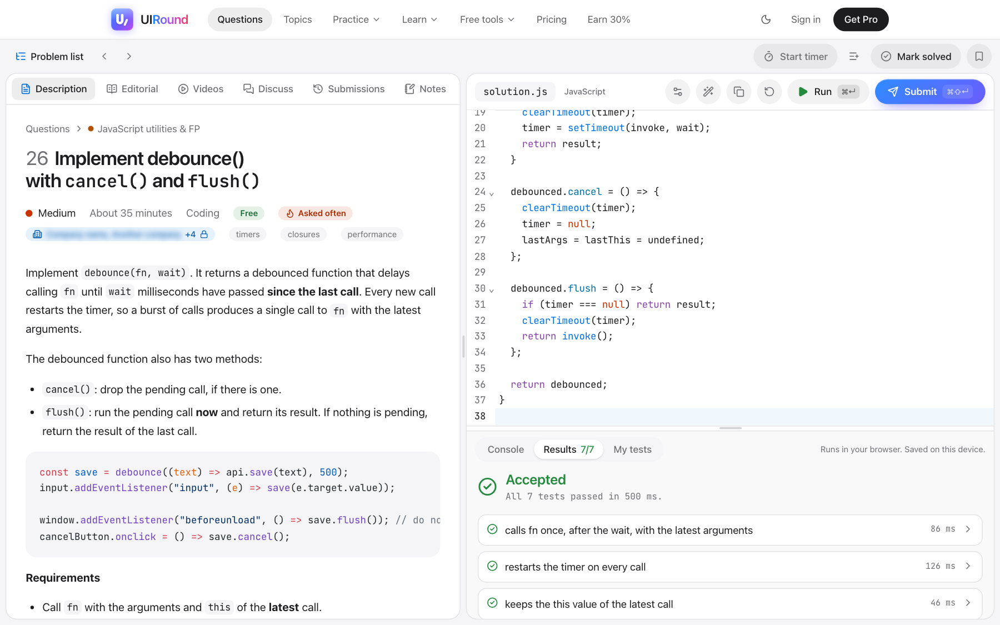
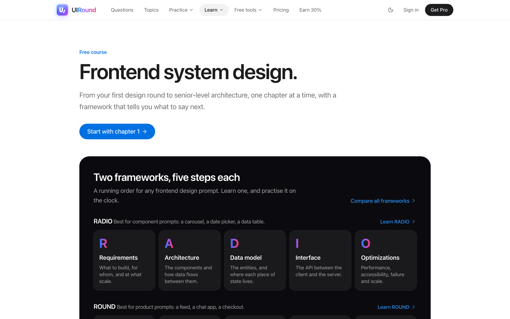
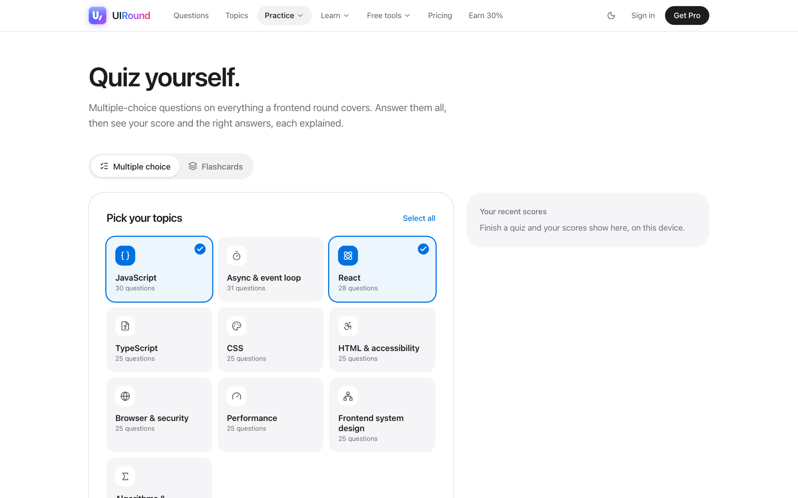

# Frontend Interview Questions and Answers

**JavaScript · React · TypeScript · HTML & CSS · Machine coding · Frontend system design**

Read each question and a short answer here, then solve it on **[UIRound](https://uiround.com)** in a browser editor with real tests, a step-by-step answer and the follow-up questions interviewers ask next. From internships and freshers to SDE-1, SDE-2, senior and staff roles.

[**Question bank**](https://uiround.com/questions) &nbsp;·&nbsp; [**System design course**](https://uiround.com/system-design) &nbsp;·&nbsp; [**Quiz and flashcards**](https://uiround.com/quiz) &nbsp;·&nbsp; [**Mock interview**](https://uiround.com/mock-interview) &nbsp;·&nbsp; [**Study plans**](https://uiround.com/study-plans)

 

  <a href="https://uiround.com/questions/implement-debounce-with-cancel-and-flush">
    <picture>
      <source media="(prefers-color-scheme: dark)" srcset="assets/editor-dark.png">
      
    </picture>
  </a>

## How it works

1. **Pick a question.** Browse by topic, by experience level or by company, or start with the [free questions](#free-questions) below.
2. **Write the code and run the tests.** JavaScript, TypeScript and React run in your browser, and hidden tests check your answer the way an interviewer would.
3. **Read the answer, then the follow-ups.** A step-by-step solution, the complexity, the edge cases, and the questions an interviewer asks next.

⭐ **Star this repo** to keep it handy and help other developers find it. Looking for a long list to read through? The open-source [Frontend Interview Questions handbook](https://github.com/sumitsingh4411/frontend-interview-questions) has 3,000+ questions with worked solutions.

## Contents

- [How it works](#how-it-works)
- [Most asked frontend interview questions](#most-asked-frontend-interview-questions)
- [Interview questions and answers by topic](#interview-questions-and-answers-by-topic)
- [Prepare by experience](#prepare-by-experience)
- [Prepare by company](#prepare-by-company)
- [Free coding questions with tests](#free-questions)
- [Guides and the system design course](#guides)
- [What you can do on the site](#what-you-can-do-on-the-site)
- [Frontend interview FAQ](#frontend-interview-faq)
- [Report a bug or ask for a feature](#found-a-bug-want-something-added)

## Most asked frontend interview questions

The questions that come up most often in public frontend interview reports, across the most companies. Each one opens with the problem, starter code and tests.

| # | Question | Level | Track | |
| --: | --- | --- | --- | --- |
| 1 | [Implement a function to flatten a nested array](https://uiround.com/questions/implement-a-function-to-flatten-a-nested-array) | Easy | JavaScript fundamentals | Free |
| 2 | [Implement Promise.all() from scratch](https://uiround.com/questions/implement-promise-all-from-scratch) | Medium | Promises & async | Free |
| 3 | [Build a todo list app in React with editing, filters and persistence](https://uiround.com/questions/build-a-todo-list-app-in-react-with-editing-filters-and-persistence) | Medium | UI machine coding | Free |
| 4 | [Implement `Function.prototype.bind()`, including partial arguments](https://uiround.com/questions/implement-function-prototype-bind-including-partial) | Easy | JavaScript fundamentals | Free |
| 5 | [Implement debounce() with `cancel()` and `flush()`](https://uiround.com/questions/implement-debounce-with-cancel-and-flush) | Medium | JavaScript utilities & FP | Free |
| 6 | [Implement `curry()` supporting partial application](https://uiround.com/questions/implement-curry-supporting-partial-application) | Medium | JavaScript utilities & FP | Free |
| 7 | [Build a typeahead/autocomplete with caching and keyboard support](https://uiround.com/questions/build-a-typeahead-autocomplete-with-caching-and-keyboard) | Medium | UI machine coding | Free |
| 8 | [Implement `memoize()` with custom cache keys](https://uiround.com/questions/implement-memoize-with-custom-cache-keys) | Medium | JavaScript utilities & FP | Free |
| 9 | [Implement an LRU cache](https://uiround.com/questions/implement-an-lru-cache) | Medium | JavaScript utilities & FP | Pro |
| 10 | [Build infinite scrolling using `IntersectionObserver`](https://uiround.com/questions/build-infinite-scrolling-using-intersectionobserver) | Medium | React application patterns | Free |
| 11 | [Turn flat `{ id, parentId }` records into a tree and an adjacency list, and find the nearest matching folder with BFS](https://uiround.com/questions/turn-flat-id-parentid-records-into-a-tree-and-an-adjacency-list-and-find-the-nearest-matching-folder-with-bfs) | Easy | Strings, objects & algorithms | Free |
| 12 | [Implement an EventEmitter with `on`, `off`, `emit`, and `once`](https://uiround.com/questions/implement-an-eventemitter-with-on-off-emit-and-once) | Medium | JavaScript utilities & FP | Pro |
| 13 | [Implement mapLimit() / throttlePromises() with maximum N concurrent tasks](https://uiround.com/questions/implement-maplimit-throttlepromises-with-maximum-n) | Medium | Concurrency & scheduling | Free |
| 14 | [Build search-as-you-type with debounce and `AbortController`](https://uiround.com/questions/build-search-as-you-type-with-debounce-and-abortcontroller) | Medium | React application patterns | Free |
| 15 | [Build a nested comments component with threaded replies](https://uiround.com/questions/build-a-nested-comments-component-with-threaded-replies) | Medium | UI machine coding | Free |
| 16 | [Design WhatsApp Web: real-time messaging, ordering, offline state and reconciliation](https://uiround.com/questions/design-whatsapp-web-real-time-messaging-ordering-offline) | Hard | Frontend system design | Free |
| 17 | [Design an autocomplete system serving millions of users with caching and request cancellation](https://uiround.com/questions/design-an-autocomplete-system-serving-millions-of-users) | Hard | Frontend system design | Free |
| 18 | [Predict hoisting and TDZ results for functions, `var`, `let`, `const` and `class`](https://uiround.com/questions/predict-hoisting-and-tdz-results-for-functions-var-let-const-and-class) | Easy | JavaScript fundamentals | Free |
| 19 | [Build an accessible carousel with autoplay that pauses on hover and focus, swipe and reduced motion](https://uiround.com/questions/build-an-accessible-carousel-with-autoplay-that-pauses-on-hover-and-focus-swipe-and-reduced-motion) | Medium | UI machine coding | Pro |
| 20 | [Implement binary search and its variants: insert position, first and last match, rotated arrays](https://uiround.com/questions/implement-binary-search-and-its-variants-insert-position-first-and-last-match-rotated-arrays) | Easy | Strings, objects & algorithms | Free |

See the full ranking on the site: [most asked first](https://uiround.com/questions?sort=most-asked).

## Interview questions and answers by topic

The concept questions interviewers open with, each with a short answer you can say out loud and a link to the full answer with examples.

| Topic | Start with |
| --- | --- |
| [JavaScript interview questions and answers](answers/javascript.md) | What is a closure in JavaScript? How does the this keyword work in JavaScript? What is hoisting in JavaScript? |
| [React interview questions and answers](answers/react.md) | What is the virtual DOM in React? How does useEffect work: dependencies and cleanup useMemo vs useCallback: what is the difference? |
| [Next.js interview questions and answers](answers/nextjs.md) | SSR vs SSG vs ISR in Next.js: when to use which? Server Components vs Client Components in Next.js: what does 'use client' do? App Router vs Pages Router in Next.js: what is the difference? |
| [State management interview questions and answers](answers/state.md) | What is Redux, and how does it work? Context API vs Redux: which should you use? What is Redux Toolkit, and why should you use it? |
| [Vue interview questions and answers](answers/vue.md) | ref vs reactive in Vue 3: what is the difference? v-if vs v-show in Vue: what is the difference? What are Vue lifecycle hooks? |
| [Angular interview questions and answers](answers/angular.md) | What are Angular lifecycle hooks and in what order do they run? What are standalone components in Angular and how do they replace NgModules? How does change detection work in Angular? |
| [CSS interview questions and answers](answers/css.md) | What is the CSS box model? Flexbox vs Grid: when to use which? How does CSS specificity work? |
| [HTML and accessibility interview questions and answers](answers/html.md) | What is semantic HTML, and why does it matter? What is ARIA, and when should you use it? How do you make a website accessible? |
| [Browser and web interview questions and answers](answers/browser.md) | What happens when you type a URL into the browser? What is CORS, and how does it work? What is the critical rendering path? |
| [TypeScript interview questions and answers](answers/typescript.md) | interface vs type in TypeScript What are generics in TypeScript? TypeScript vs JavaScript: why use TypeScript? |
| [Performance interview questions and answers](answers/performance.md) | What are Core Web Vitals: LCP, INP and CLS? What is lazy loading for images and routes? What is a CDN, and how does it make sites faster? |
| [Security interview questions and answers](answers/security.md) | What is XSS, and how do you prevent it? What is CSRF, and how do you prevent it? Should you store a JWT in localStorage or a cookie? |
| [Testing interview questions and answers](answers/testing.md) | Unit vs integration vs end-to-end tests What is React Testing Library, and how should you test components? jest.fn vs jest.spyOn vs jest.mock: what is the difference? |
| [Networking and HTTP interview questions and answers](answers/networking.md) | How does HTTP caching work? Freshness, validation and 304 responses Forward proxy vs reverse proxy: what is the difference? How does DNS resolution work? |
| [Design patterns and architecture interview questions and answers](answers/patterns.md) | What are design patterns in JavaScript and which ones matter for frontend? Micro-frontends: when do they help and when do they hurt? Composition vs inheritance in React: why does React favour composition? |
| [Behavioral and career interview questions and answers](answers/career.md) | How should a frontend engineer answer "Tell me about yourself"? How do you answer "What are your strengths and weaknesses?" as a frontend engineer How do you answer "Why do you want to work here?" |

## Prepare by experience

- [College students and interns](https://uiround.com/interview-questions/frontend-internship): Frontend and web developer internship interview questions for college students: HTML, CSS, JavaScript basics, DOM, simple React and easy coding problems.
- [Freshers (0–1 years)](https://uiround.com/interview-questions/freshers): Frontend interview questions for freshers with tested answers: JavaScript fundamentals, polyfills, strings and arrays, DOM and events, CSS layout, and output-based puzzles that are asked in first frontend interviews.
- [SDE-1 (0–2 years)](https://uiround.com/interview-questions/sde-1-frontend): SDE-1 frontend interview questions with tested answers: JavaScript fundamentals, DOM, HTML and CSS, React hooks, small machine coding builds and easy DSA.
- [SDE-2 (2–5 years)](https://uiround.com/interview-questions/sde-2-frontend): SDE-2 frontend interview questions with tested answers: async JavaScript, React hooks and patterns, machine coding rounds and browser performance.
- [JavaScript for 3–5+ years](https://uiround.com/interview-questions/javascript-experienced): JavaScript interview questions for 3 and 5 years of experience: async utilities, promise combinators, concurrency limits, cancellation, caching and browser architecture, with tested answers.
- [React for 3–5+ years](https://uiround.com/interview-questions/react-experienced): React interview questions for 3 and 5 years of experience: custom hooks, re-renders and memoization, state architecture, concurrent rendering, server components and machine coding, with tested answers.
- [Senior (5+ years)](https://uiround.com/interview-questions/senior-frontend): Senior frontend interview questions: system design, advanced React, concurrency and cancellation, browser architecture and large-scale machine coding.
- [Staff and principal](https://uiround.com/interview-questions/staff-frontend): Staff and principal frontend interview questions: large-scale frontend system design, architecture, performance at scale, platform work and technical leadership.

Not sure which level you are interviewing for? Read [SDE-1 vs SDE-2 vs senior vs staff frontend engineer](https://uiround.com/guides/sde-1-vs-sde-2-vs-senior-vs-staff-frontend).

## Prepare by company

- [FAANG and big tech](https://uiround.com/interview-questions/faang-frontend): FAANG frontend interview questions with tested answers: algorithmic JavaScript, UI components built from scratch, frontend system design, and reported questions.
- [Startups](https://uiround.com/interview-questions/startup-frontend): Startup frontend interview questions: build complete features fast with React and Next.js, data fetching, forms, performance and product thinking.
- [TCS, Infosys, Wipro, Accenture and other service companies](https://uiround.com/interview-questions/service-company-frontend): Frontend developer interview questions for TCS, Infosys, Wipro, Accenture, Cognizant and other IT services companies: JavaScript, HTML, CSS, React and Angular.

How each company runs its frontend interviews, round by round, from public interview reports:

**FAANG and big tech:** [Google](https://uiround.com/companies/google) · [Meta](https://uiround.com/companies/meta) · [Amazon](https://uiround.com/companies/amazon) · [Microsoft](https://uiround.com/companies/microsoft) · [Apple](https://uiround.com/companies/apple) · [Netflix](https://uiround.com/companies/netflix) · [Uber](https://uiround.com/companies/uber) · [LinkedIn](https://uiround.com/companies/linkedin) · [Atlassian](https://uiround.com/companies/atlassian) · [Salesforce](https://uiround.com/companies/salesforce) · [Adobe](https://uiround.com/companies/adobe) · [Airbnb](https://uiround.com/companies/airbnb) · [Intuit](https://uiround.com/companies/intuit) · [Walmart Global Tech](https://uiround.com/companies/walmart)

**Global scale-ups:** [Stripe](https://uiround.com/companies/stripe) · [Databricks](https://uiround.com/companies/databricks) · [Rippling](https://uiround.com/companies/rippling) · [Snowflake](https://uiround.com/companies/snowflake) · [Sprinklr](https://uiround.com/companies/sprinklr) · [ThoughtSpot](https://uiround.com/companies/thoughtspot)

**Indian product companies and startups:** [Flipkart](https://uiround.com/companies/flipkart) · [Swiggy](https://uiround.com/companies/swiggy) · [Zomato](https://uiround.com/companies/zomato) · [Razorpay](https://uiround.com/companies/razorpay) · [PhonePe](https://uiround.com/companies/phonepe) · [CRED](https://uiround.com/companies/cred) · [Meesho](https://uiround.com/companies/meesho) · [Zepto](https://uiround.com/companies/zepto) · [Myntra](https://uiround.com/companies/myntra) · [Paytm](https://uiround.com/companies/paytm) · [Dream11](https://uiround.com/companies/dream11) · [Groww](https://uiround.com/companies/groww) · [MakeMyTrip](https://uiround.com/companies/makemytrip) · [Media.net](https://uiround.com/companies/media-net) · [Navi](https://uiround.com/companies/navi) · [Zeta](https://uiround.com/companies/zeta)

**IT services and consulting:** [Accenture](https://uiround.com/companies/accenture) · [Capgemini](https://uiround.com/companies/capgemini) · [Cognizant](https://uiround.com/companies/cognizant) · [HCLTech](https://uiround.com/companies/hcltech) · [Infosys](https://uiround.com/companies/infosys) · [TCS](https://uiround.com/companies/tcs) · [Tech Mahindra](https://uiround.com/companies/tech-mahindra) · [Wipro](https://uiround.com/companies/wipro)

## What you can do on the site

<table>
<tr>
<td width="33%" valign="top">
<h3>⚡ Solve in a real editor</h3>

JavaScript, React and TypeScript run in the browser, and hidden tests check your answer.

<a href="https://uiround.com/javascript-editor">JavaScript editor</a> · <a href="https://uiround.com/react-editor">React editor</a>

</td>
<td width="33%" valign="top">
<h3>🧩 React, Vue, Angular or Svelte</h3>

Machine coding questions come with a version for each framework.

<a href="https://uiround.com/interview-questions/vue">Vue</a> · <a href="https://uiround.com/interview-questions/angular">Angular</a> · <a href="https://uiround.com/interview-questions/svelte">Svelte</a>

</td>
<td width="33%" valign="top">
<h3>🔷 TypeScript type challenges</h3>

Type-level questions are checked by the TypeScript compiler as you type.

<a href="https://uiround.com/interview-questions/typescript">TypeScript questions</a>

</td>
</tr>
<tr>
<td width="33%" valign="top">
<h3>🏗️ Frontend system design</h3>

A free course from beginner to advanced, with case studies and a whiteboard.

<a href="https://uiround.com/system-design">Start the course</a>

</td>
<td width="33%" valign="top">
<h3>⏱️ Mock interviews</h3>

A timed round in JavaScript, React or system design, scored out of 100.

<a href="https://uiround.com/mock-interview">Take a mock interview</a>

</td>
<td width="33%" valign="top">
<h3>✅ Quiz and flashcards</h3>

Multiple-choice questions on every frontend topic, each answer explained.

<a href="https://uiround.com/quiz">Quiz yourself</a>

</td>
</tr>
<tr>
<td width="33%" valign="top">
<h3>📅 Interview planner</h3>

Tell it the company, the date and your hours a day; get a day-by-day plan.

<a href="https://uiround.com/interview-planner">Make a plan</a>

</td>
<td width="33%" valign="top">
<h3>🗺️ Study plans and roadmaps</h3>

1 week, 1 month or 3 months, a four-week roadmap and a must-solve list. Finish one for a certificate.

<a href="https://uiround.com/study-plans">Study plans</a> · <a href="https://uiround.com/frontend-interview-roadmap">Roadmap</a> · <a href="https://uiround.com/must-solve">Must-solve</a>

</td>
<td width="33%" valign="top">
<h3>🏢 Interview experiences</h3>

Rounds and questions shared by candidates, and how companies run their frontend interviews.

<a href="https://uiround.com/interview-experiences">Experiences</a> · <a href="https://uiround.com/companies">Companies</a>

</td>
</tr>
<tr>
<td width="33%" valign="top">
<h3>🔁 Spaced revision</h3>

Solved questions come back for revision before you forget them.

</td>
<td width="33%" valign="top">
<h3>🏆 Leaderboard</h3>

Every accepted solution earns points: 10 for easy, 20 for medium, 40 for hard.

<a href="https://uiround.com/leaderboard">See the leaderboard</a>

</td>
<td width="33%" valign="top">
<h3>📈 Progress on every device</h3>

Mark questions solved, bookmark them and make your own lists.

</td>
</tr>
</table>

| [Question bank](https://uiround.com/questions) | [System design course](https://uiround.com/system-design) | [Quiz and flashcards](https://uiround.com/quiz) |
| --- | --- | --- |
|  |  |  |

## Free questions

Every track has free questions with the complete answer on the site. Each link below opens the problem, starter code and hints in this repository; the last column opens it on the site.

### Easy

| Question | Track | Practice |
| --- | --- | --- |
| [Implement Function.prototype.bind(), including partial arguments](questions/js-fundamentals/006-implement-function-prototype-bind-including-partial.md) | JavaScript fundamentals | [Solve with tests](https://uiround.com/questions/implement-function-prototype-bind-including-partial) |
| [Implement a function to flatten a nested array](questions/js-fundamentals/008-implement-a-function-to-flatten-a-nested-array.md) | JavaScript fundamentals | [Solve with tests](https://uiround.com/questions/implement-a-function-to-flatten-a-nested-array) |
| [Predict the event-loop order of setTimeout, promises, queueMicrotask and await](questions/js-fundamentals/151-predict-the-event-loop-order-of-settimeout-promises-queuemicrotask-and-await.md) | JavaScript fundamentals | [Solve with tests](https://uiround.com/questions/predict-the-event-loop-order-of-settimeout-promises-queuemicrotask-and-await) |
| [Predict hoisting and TDZ results for functions, var, let, const and class](questions/js-fundamentals/178-predict-hoisting-and-tdz-results-for-functions-var-let-const-and-class.md) | JavaScript fundamentals | [Solve with tests](https://uiround.com/questions/predict-hoisting-and-tdz-results-for-functions-var-let-const-and-class) |
| [Valid parentheses using a stack](questions/strings-objects-algorithms/012-valid-parentheses-using-a-stack.md) | Strings, objects & algorithms | [Solve with tests](https://uiround.com/questions/valid-parentheses-using-a-stack) |
| [Two Sum using a hash map](questions/strings-objects-algorithms/013-two-sum-using-a-hash-map.md) | Strings, objects & algorithms | [Solve with tests](https://uiround.com/questions/two-sum-using-a-hash-map) |
| [Implement binary search and its variants: insert position, first and last match, rotated arrays](questions/strings-objects-algorithms/351-implement-binary-search-and-its-variants-insert-position-first-and-last-match-rotated-arrays.md) | Strings, objects & algorithms | [Solve with tests](https://uiround.com/questions/implement-binary-search-and-its-variants-insert-position-first-and-last-match-rotated-arrays) |
| [Turn flat { id, parentId } records into a tree and an adjacency list, and find the nearest matching folder with BFS](questions/strings-objects-algorithms/711-turn-flat-id-parentid-records-into-a-tree-and-an-adjacency-list-and-find-the-nearest-matching-folder-with-bfs.md) | Strings, objects & algorithms | [Solve with tests](https://uiround.com/questions/turn-flat-id-parentid-records-into-a-tree-and-an-adjacency-list-and-find-the-nearest-matching-folder-with-bfs) |
| [Implement event delegation for a dynamic list](questions/dom-fundamentals/022-implement-event-delegation-for-a-dynamic-list.md) | Browser & DOM fundamentals | [Solve with tests](https://uiround.com/questions/implement-event-delegation-for-a-dynamic-list) |
| [Build an accessible star-rating widget with keyboard support and a read-only mode](questions/dom-fundamentals/156-build-an-accessible-star-rating-widget-with-keyboard-support-and-a-read-only-mode.md) | Browser & DOM fundamentals | [Solve with tests](https://uiround.com/questions/build-an-accessible-star-rating-widget-with-keyboard-support-and-a-read-only-mode) |
| [Put the steps from typing a URL to first paint in order, and mark what blocks rendering](questions/dom-fundamentals/179-put-the-steps-from-typing-a-url-to-first-paint-in-order-and-mark-what-blocks-rendering.md) | Browser & DOM fundamentals | [Solve with tests](https://uiround.com/questions/put-the-steps-from-typing-a-url-to-first-paint-in-order-and-mark-what-blocks-rendering) |
| [Predict which color wins: specificity, !important and cascade layers](questions/dom-fundamentals/180-predict-which-color-wins-specificity-important-and-cascade-layers.md) | Browser & DOM fundamentals | [Solve with tests](https://uiround.com/questions/predict-which-color-wins-specificity-important-and-cascade-layers) |
| [Implement Pick and Omit as TypeScript utility types](questions/typescript-basics/917-implement-pick-and-omit-as-typescript-utility-types.md) | TypeScript utility types | [Solve with tests](https://uiround.com/questions/implement-pick-and-omit-as-typescript-utility-types) |
| [Implement Partial, Required and Readonly as mapped types](questions/typescript-basics/918-implement-partial-required-and-readonly-as-mapped-types.md) | TypeScript utility types | [Solve with tests](https://uiround.com/questions/implement-partial-required-and-readonly-as-mapped-types) |
| [Implement Record and use it to type a lookup table](questions/typescript-basics/919-implement-record-and-use-it-to-type-a-lookup-table.md) | TypeScript utility types | [Solve with tests](https://uiround.com/questions/implement-record-and-use-it-to-type-a-lookup-table) |
| [Implement Exclude, Extract and NonNullable with distributive conditional types](questions/typescript-basics/920-implement-exclude-extract-and-nonnullable-with-distributive-conditional-types.md) | TypeScript utility types | [Solve with tests](https://uiround.com/questions/implement-exclude-extract-and-nonnullable-with-distributive-conditional-types) |
| [Mark up a recipe page with semantic HTML only](questions/html-css/956-mark-up-a-recipe-page-with-semantic-html-only.md) | HTML & CSS | [Solve with tests](https://uiround.com/questions/mark-up-a-recipe-page-with-semantic-html-only) |
| [Truncate text with an ellipsis on one line and clamp it to three lines](questions/html-css/957-truncate-text-with-an-ellipsis-on-one-line-and-clamp-it-to-three-lines.md) | HTML & CSS | [Solve with tests](https://uiround.com/questions/truncate-text-with-an-ellipsis-on-one-line-and-clamp-it-to-three-lines) |
| [Write mobile-first media queries for a product listing page: two, three and four columns and a filter sidebar](questions/html-css/1235-write-mobile-first-media-queries-for-a-product-listing-page-two-three-and-four-columns-and-a-filter.md) | HTML & CSS | [Solve with tests](https://uiround.com/questions/write-mobile-first-media-queries-for-a-product-listing-page-two-three-and-four-columns-and-a-filter) |
| [Restyle a card list with CSS only, without editing the HTML or the existing stylesheet](questions/html-css/1248-restyle-a-card-list-with-css-only-without-editing-the-html-or-the-existing-stylesheet.md) | HTML & CSS | [Solve with tests](https://uiround.com/questions/restyle-a-card-list-with-css-only-without-editing-the-html-or-the-existing-stylesheet) |

### Medium

| Question | Track | Practice |
| --- | --- | --- |
| [Implement debounce() with cancel() and flush()](questions/js-utilities/026-implement-debounce-with-cancel-and-flush.md) | JavaScript utilities & FP | [Solve with tests](https://uiround.com/questions/implement-debounce-with-cancel-and-flush) |
| [Implement throttle() with leading and trailing options](questions/js-utilities/027-implement-throttle-with-leading-and-trailing-options.md) | JavaScript utilities & FP | [Solve with tests](https://uiround.com/questions/implement-throttle-with-leading-and-trailing-options) |
| [Implement curry() supporting partial application](questions/js-utilities/028-implement-curry-supporting-partial-application.md) | JavaScript utilities & FP | [Solve with tests](https://uiround.com/questions/implement-curry-supporting-partial-application) |
| [Implement memoize() with custom cache keys](questions/js-utilities/031-implement-memoize-with-custom-cache-keys.md) | JavaScript utilities & FP | [Solve with tests](https://uiround.com/questions/implement-memoize-with-custom-cache-keys) |
| [Implement Promise.all() from scratch](questions/promises-async/036-implement-promise-all-from-scratch.md) | Promises & async | [Solve with tests](https://uiround.com/questions/implement-promise-all-from-scratch) |
| [Implement Promise.allSettled()](questions/promises-async/037-implement-promise-allsettled.md) | Promises & async | [Solve with tests](https://uiround.com/questions/implement-promise-allsettled) |
| [Implement Promise.race()](questions/promises-async/038-implement-promise-race.md) | Promises & async | [Solve with tests](https://uiround.com/questions/implement-promise-race) |
| [Sequential versus parallel awaits: predict how long each snippet takes, then fix the slow ones](questions/promises-async/735-sequential-versus-parallel-awaits-predict-how-long-each-snippet-takes-then-fix-the-slow-ones.md) | Promises & async | [Solve with tests](https://uiround.com/questions/sequential-versus-parallel-awaits-predict-how-long-each-snippet-takes-then-fix-the-slow-ones) |
| [Implement mapLimit() / throttlePromises() with maximum N concurrent tasks](questions/concurrency-scheduling/046-implement-maplimit-throttlepromises-with-maximum-n.md) | Concurrency & scheduling | [Solve with tests](https://uiround.com/questions/implement-maplimit-throttlepromises-with-maximum-n) |
| [Implement a token-bucket API rate limiter](questions/concurrency-scheduling/051-implement-a-token-bucket-api-rate-limiter.md) | Concurrency & scheduling | [Solve with tests](https://uiround.com/questions/implement-a-token-bucket-api-rate-limiter) |
| [Implement a concurrency-safe async cache with TTL](questions/concurrency-scheduling/054-implement-a-concurrency-safe-async-cache-with-ttl.md) | Concurrency & scheduling | [Solve with tests](https://uiround.com/questions/implement-a-concurrency-safe-async-cache-with-ttl) |
| [Build an async.queue-style task queue and a two-at-a-time FIFO or LIFO callback queue](questions/concurrency-scheduling/739-build-an-async-queue-style-task-queue-and-a-two-at-a-time-fifo-or-lifo-callback-queue.md) | Concurrency & scheduling | [Solve with tests](https://uiround.com/questions/build-an-async-queue-style-task-queue-and-a-two-at-a-time-fifo-or-lifo-callback-queue) |
| [Implement useDebounce() for values](questions/react-hooks-state/056-implement-usedebounce-for-values.md) | React hooks & state | [Solve with tests](https://uiround.com/questions/implement-usedebounce-for-values) |
| [Implement useInterval() without stale closures](questions/react-hooks-state/059-implement-useinterval-without-stale-closures.md) | React hooks & state | [Solve with tests](https://uiround.com/questions/implement-useinterval-without-stale-closures) |
| [Implement a small Redux-style store using subscriptions and reducers](questions/react-hooks-state/064-implement-a-small-redux-style-store-using-subscriptions-and.md) | React hooks & state | [Solve with tests](https://uiround.com/questions/implement-a-small-redux-style-store-using-subscriptions-and) |
| [Implement useMemo, useCallback and useRef from scratch](questions/react-hooks-state/319-implement-usememo-usecallback-and-useref-from-scratch.md) | React hooks & state | [Solve with tests](https://uiround.com/questions/implement-usememo-usecallback-and-useref-from-scratch) |
| [Build search-as-you-type with debounce and AbortController](questions/react-patterns/066-build-search-as-you-type-with-debounce-and-abortcontroller.md) | React application patterns | [Solve with tests](https://uiround.com/questions/build-search-as-you-type-with-debounce-and-abortcontroller) |
| [Build infinite scrolling using IntersectionObserver](questions/react-patterns/068-build-infinite-scrolling-using-intersectionobserver.md) | React application patterns | [Solve with tests](https://uiround.com/questions/build-infinite-scrolling-using-intersectionobserver) |
| [Implement a virtualized list rendering 100,000 items efficiently](questions/react-patterns/075-implement-a-virtualized-list-rendering-100-000-items.md) | React application patterns | [Solve with tests](https://uiround.com/questions/implement-a-virtualized-list-rendering-100-000-items) |
| [Review a React pull request: find the bugs, security holes, accessibility and performance problems](questions/react-patterns/773-review-a-react-pull-request-find-the-bugs-security-holes-accessibility-and-performance-problems.md) | React application patterns | [Solve with tests](https://uiround.com/questions/review-a-react-pull-request-find-the-bugs-security-holes-accessibility-and-performance-problems) |
| [Build a typeahead/autocomplete with caching and keyboard support](questions/ui-machine-coding/077-build-a-typeahead-autocomplete-with-caching-and-keyboard.md) | UI machine coding | [Solve with tests](https://uiround.com/questions/build-a-typeahead-autocomplete-with-caching-and-keyboard) |
| [Build a nested comments component with threaded replies](questions/ui-machine-coding/081-build-a-nested-comments-component-with-threaded-replies.md) | UI machine coding | [Solve with tests](https://uiround.com/questions/build-a-nested-comments-component-with-threaded-replies) |
| [Build tic-tac-toe on an N×N board with M in a row to win](questions/ui-machine-coding/226-build-tic-tac-toe-on-an-n-by-n-board-with-m-in-a-row-to-win.md) | UI machine coding | [Solve with tests](https://uiround.com/questions/build-tic-tac-toe-on-an-n-by-n-board-with-m-in-a-row-to-win) |
| [Build a todo list app in React with editing, filters and persistence](questions/ui-machine-coding/320-build-a-todo-list-app-in-react-with-editing-filters-and-persistence.md) | UI machine coding | [Solve with tests](https://uiround.com/questions/build-a-todo-list-app-in-react-with-editing-filters-and-persistence) |
| [Implement a fetch wrapper with timeout and AbortController](questions/browser-network-performance/086-implement-a-fetch-wrapper-with-timeout-and-abortcontroller.md) | Browser, network & performance | [Solve with tests](https://uiround.com/questions/implement-a-fetch-wrapper-with-timeout-and-abortcontroller) |
| [Implement retry with exponential backoff and jitter](questions/browser-network-performance/088-implement-retry-with-exponential-backoff-and-jitter.md) | Browser, network & performance | [Solve with tests](https://uiround.com/questions/implement-retry-with-exponential-backoff-and-jitter) |
| [Implement an analytics SDK with event batching and sendBeacon fallback](questions/browser-network-performance/094-implement-an-analytics-sdk-with-event-batching-and.md) | Browser, network & performance | [Solve with tests](https://uiround.com/questions/implement-an-analytics-sdk-with-event-batching-and) |
| [Work out when scripts run: classic, async, defer, module and inline scripts against the parser](questions/browser-network-performance/1314-work-out-when-scripts-run-classic-async-defer-module-and-inline-scripts-against-the-parser.md) | Browser, network & performance | [Solve with tests](https://uiround.com/questions/work-out-when-scripts-run-classic-async-defer-module-and-inline-scripts-against-the-parser) |
| [Build a binary search tree class with insert, search, delete and in-order traversal](questions/dsa-patterns/982-build-a-binary-search-tree-class-with-insert-search-delete-and-in-order-traversal.md) | Algorithms & data structures | [Solve with tests](https://uiround.com/questions/build-a-binary-search-tree-class-with-insert-search-delete-and-in-order-traversal) |
| [Validate a binary search tree](questions/dsa-patterns/983-validate-a-binary-search-tree.md) | Algorithms & data structures | [Solve with tests](https://uiround.com/questions/validate-a-binary-search-tree) |
| [Find the lowest common ancestor in a BST and in a plain binary tree](questions/dsa-patterns/985-find-the-lowest-common-ancestor-in-a-bst-and-in-a-plain-binary-tree.md) | Algorithms & data structures | [Solve with tests](https://uiround.com/questions/find-the-lowest-common-ancestor-in-a-bst-and-in-a-plain-binary-tree) |
| [Compute trapped rain water with two pointers](questions/dsa-patterns/1004-compute-trapped-rain-water-with-two-pointers.md) | Algorithms & data structures | [Solve with tests](https://uiround.com/questions/compute-trapped-rain-water-with-two-pointers) |
| [Implement IsNever, IsAny and IsUnknown without being fooled by distribution](questions/typescript-types/930-implement-isnever-isany-and-isunknown-without-being-fooled-by-distribution.md) | TypeScript type challenges | [Solve with tests](https://uiround.com/questions/implement-isnever-isany-and-isunknown-without-being-fooled-by-distribution) |
| [Write a strict Equal<A, B> type and explain why the simple version fails](questions/typescript-types/931-write-a-strict-equal-a-b-type-and-explain-why-the-simple-version-fails.md) | TypeScript type challenges | [Solve with tests](https://uiround.com/questions/write-a-strict-equal-a-b-type-and-explain-why-the-simple-version-fails) |
| [Implement DeepReadonly and DeepPartial for nested objects, arrays and functions](questions/typescript-types/932-implement-deepreadonly-and-deeppartial-for-nested-objects-arrays-and-functions.md) | TypeScript type challenges | [Solve with tests](https://uiround.com/questions/implement-deepreadonly-and-deeppartial-for-nested-objects-arrays-and-functions) |
| [Implement TrimLeft, TrimRight and Trim for string literal types](questions/typescript-types/933-implement-trimleft-trimright-and-trim-for-string-literal-types.md) | TypeScript type challenges | [Solve with tests](https://uiround.com/questions/implement-trimleft-trimright-and-trim-for-string-literal-types) |

### Hard

| Question | Track | Practice |
| --- | --- | --- |
| [Implement a Promise library with .then(), .catch(), chaining, and asynchronous handler scheduling](questions/advanced-concurrency/101-implement-a-promise-library-with-then-catch-chaining-and.md) | Advanced async concurrency | [Solve with tests](https://uiround.com/questions/implement-a-promise-library-with-then-catch-chaining-and) |
| [Implement a task scheduler with concurrency limits, priorities, cancellation, and starvation prevention](questions/advanced-concurrency/102-implement-a-task-scheduler-with-concurrency-limits.md) | Advanced async concurrency | [Solve with tests](https://uiround.com/questions/implement-a-task-scheduler-with-concurrency-limits) |
| [Implement an asynchronous dependency graph executor where tasks run only after their dependencies complete](questions/advanced-concurrency/105-implement-an-asynchronous-dependency-graph-executor-where.md) | Advanced async concurrency | [Solve with tests](https://uiround.com/questions/implement-an-asynchronous-dependency-graph-executor-where) |
| [Implement a single-flight token refresh mechanism: 10 failed requests trigger only one refresh, followed by safe retries](questions/advanced-concurrency/108-implement-a-single-flight-token-refresh-mechanism-10-failed.md) | Advanced async concurrency | [Solve with tests](https://uiround.com/questions/implement-a-single-flight-token-refresh-mechanism-10-failed) |
| [Implement a minimal React-like renderer with virtual DOM diffing and keyed reconciliation](questions/advanced-react/111-implement-a-minimal-react-like-renderer-with-virtual-dom.md) | Advanced React & rendering | [Solve with tests](https://uiround.com/questions/implement-a-minimal-react-like-renderer-with-virtual-dom) |
| [Implement a mini useState and useEffect hooks engine](questions/advanced-react/112-implement-a-mini-usestate-and-useeffect-hooks-engine.md) | Advanced React & rendering | [Solve with tests](https://uiround.com/questions/implement-a-mini-usestate-and-useeffect-hooks-engine) |
| [Implement a fine-grained external state store using useSyncExternalStore without tearing](questions/advanced-react/113-implement-a-fine-grained-external-state-store-using.md) | Advanced React & rendering | [Solve with tests](https://uiround.com/questions/implement-a-fine-grained-external-state-store-using) |
| [Build a schema-driven form with conditional fields and pluggable field types](questions/advanced-react/197-build-a-schema-driven-form-with-conditional-fields-and-pluggable-field-types.md) | Advanced React & rendering | [Solve with tests](https://uiround.com/questions/build-a-schema-driven-form-with-conditional-fields-and-pluggable-field-types) |
| [Implement a simplified HTML parser and DOM tree builder](questions/advanced-browser-architecture/122-implement-a-simplified-html-parser-and-dom-tree-builder.md) | Advanced JS, browser & architecture | [Solve with tests](https://uiround.com/questions/implement-a-simplified-html-parser-and-dom-tree-builder) |
| [Implement a reactive dependency system with automatic dependency tracking](questions/advanced-browser-architecture/123-implement-a-reactive-dependency-system-with-automatic.md) | Advanced JS, browser & architecture | [Solve with tests](https://uiround.com/questions/implement-a-reactive-dependency-system-with-automatic) |
| [Implement an HTTP cache with ETag validation, stale-while-revalidate, and request deduplication](questions/advanced-browser-architecture/126-implement-an-http-cache-with-etag-validation-stale-while.md) | Advanced JS, browser & architecture | [Solve with tests](https://uiround.com/questions/implement-an-http-cache-with-etag-validation-stale-while) |
| [Design a micro-frontend shell with independent deployment and shared dependency versioning](questions/advanced-browser-architecture/128-design-a-micro-frontend-shell-with-independent-deployment.md) | Advanced JS, browser & architecture | [Design it on the whiteboard](https://uiround.com/questions/design-a-micro-frontend-shell-with-independent-deployment) |
| [Implement UnionToIntersection with contravariant inference](questions/advanced-typescript-types/944-implement-uniontointersection-with-contravariant-inference.md) | Advanced TypeScript types | [Solve with tests](https://uiround.com/questions/implement-uniontointersection-with-contravariant-inference) |
| [Implement ObjectPaths: every dot-separated path of a nested object type](questions/advanced-typescript-types/945-implement-objectpaths-every-dot-separated-path-of-a-nested-object-type.md) | Advanced TypeScript types | [Solve with tests](https://uiround.com/questions/implement-objectpaths-every-dot-separated-path-of-a-nested-object-type) |
| [Add and subtract number literal types with tuple arithmetic](questions/advanced-typescript-types/946-add-and-subtract-number-literal-types-with-tuple-arithmetic.md) | Advanced TypeScript types | [Solve with tests](https://uiround.com/questions/add-and-subtract-number-literal-types-with-tuple-arithmetic) |
| [Multiply and integer-divide number literal types, and implement Abs](questions/advanced-typescript-types/947-multiply-and-integer-divide-number-literal-types-and-implement-abs.md) | Advanced TypeScript types | [Solve with tests](https://uiround.com/questions/multiply-and-integer-divide-number-literal-types-and-implement-abs) |
| [Design WhatsApp Web: real-time messaging, ordering, offline state and reconciliation](questions/frontend-system-design/131-design-whatsapp-web-real-time-messaging-ordering-offline.md) | Frontend system design | [Design it on the whiteboard](https://uiround.com/questions/design-whatsapp-web-real-time-messaging-ordering-offline) |
| [Design an autocomplete system serving millions of users with caching and request cancellation](questions/frontend-system-design/137-design-an-autocomplete-system-serving-millions-of-users.md) | Frontend system design | [Design it on the whiteboard](https://uiround.com/questions/design-an-autocomplete-system-serving-millions-of-users) |
| [Design Google Maps/Uber live tracking: map rendering, location updates, smoothing, and state synchronization](questions/frontend-system-design/140-design-google-maps-uber-live-tracking-map-rendering.md) | Frontend system design | [Design it on the whiteboard](https://uiround.com/questions/design-google-maps-uber-live-tracking-map-rendering) |
| [Design a news feed with infinite scroll](questions/frontend-system-design/204-design-a-news-feed-with-infinite-scroll.md) | Frontend system design | [Design it on the whiteboard](https://uiround.com/questions/design-a-news-feed-with-infinite-scroll) |
| [Build a Trello-like Kanban app supporting nested cards, drag-and-drop, undo/redo, and persistence](questions/advanced-machine-coding-dsa/145-build-a-trello-like-kanban-app-supporting-nested-cards-drag.md) | Advanced machine coding & DSA | [Solve with tests](https://uiround.com/questions/build-a-trello-like-kanban-app-supporting-nested-cards-drag) |
| [Implement an autocomplete search engine using a Trie](questions/advanced-machine-coding-dsa/146-implement-an-autocomplete-search-engine-using-a-trie.md) | Advanced machine coding & DSA | [Solve with tests](https://uiround.com/questions/implement-an-autocomplete-search-engine-using-a-trie) |
| [Implement a dependency resolver using topological sorting](questions/advanced-machine-coding-dsa/147-implement-a-dependency-resolver-using-topological-sorting.md) | Advanced machine coding & DSA | [Solve with tests](https://uiround.com/questions/implement-a-dependency-resolver-using-topological-sorting) |
| [Find the longest valid parentheses substring](questions/advanced-machine-coding-dsa/1019-find-the-longest-valid-parentheses-substring.md) | Advanced machine coding & DSA | [Solve with tests](https://uiround.com/questions/find-the-longest-valid-parentheses-substring) |

See them all on the site: [free questions](https://uiround.com/questions?access=free).

## Tracks

Questions are grouped into tracks, from warm-ups to senior-level system design.

**Easy**

- [JavaScript fundamentals](https://uiround.com/questions?category=js-fundamentals): Rebuild the core array and function methods every interviewer expects you to know cold.
- [Strings, objects & algorithms](https://uiround.com/questions?category=strings-objects-algorithms): Hash maps, stacks and object utilities that show up in every warm-up round.
- [Browser & DOM fundamentals](https://uiround.com/questions?category=dom-fundamentals): Traverse, query and wire up the DOM without a framework.
- [TypeScript utility types](https://uiround.com/questions?category=typescript-basics): Rebuild Pick, Omit, Partial, Readonly and the other built-in utility types, checked by the real compiler.
- [HTML & CSS](https://uiround.com/questions?category=html-css): Hands-on markup and styling tasks: semantic pages, tables, counters, hairlines, charts and layouts in pure CSS.

**Medium**

- [JavaScript utilities & FP](https://uiround.com/questions?category=js-utilities): debounce, throttle, curry, deep clone, LRU — the utility belt of senior rounds.
- [Promises & async](https://uiround.com/questions?category=promises-async): Promise combinators and async helpers implemented from scratch.
- [Concurrency & scheduling](https://uiround.com/questions?category=concurrency-scheduling): Pools, queues, rate limiters and batching with bounded concurrency.
- [React hooks & state](https://uiround.com/questions?category=react-hooks-state): Custom hooks without stale closures, plus a store built from first principles.
- [React application patterns](https://uiround.com/questions?category=react-patterns): Search, optimistic UI, pagination, forms and virtualization done right.
- [UI machine coding](https://uiround.com/questions?category=ui-machine-coding): Accessible, keyboard-friendly widgets built under interview time pressure.
- [Browser, network & performance](https://uiround.com/questions?category=browser-network-performance): Fetch wrappers, routers, workers, caching and Web Vitals in practice.
- [Algorithms & data structures](https://uiround.com/questions?category=dsa-patterns): Trees, linked lists, intervals, sliding windows and dynamic programming: the patterns behind algorithm rounds.
- [TypeScript type challenges](https://uiround.com/questions?category=typescript-types): Type-level puzzles checked by the real compiler: infer, template literal types, tuples and recursion.

**Hard**

- [Advanced async concurrency](https://uiround.com/questions?category=advanced-concurrency): Schedulers, cancellation, backpressure and resilience patterns.
- [Advanced React & rendering](https://uiround.com/questions?category=advanced-react): Reconciliation, hooks internals, concurrent rendering and SSR edge cases.
- [Advanced JS, browser & architecture](https://uiround.com/questions?category=advanced-browser-architecture): Sandboxes, parsers, reactivity, offline sync and secure messaging.
- [Advanced TypeScript types](https://uiround.com/questions?category=advanced-typescript-types): Union to intersection, typed paths, parsers in the type system and other senior-level type puzzles.
- [Frontend system design](https://uiround.com/questions?category=frontend-system-design): Design the frontends of WhatsApp, Docs, YouTube, Sheets and more.
- [Advanced machine coding & DSA](https://uiround.com/questions?category=advanced-machine-coding-dsa): Spreadsheets, editors, IDEs and the data structures behind them.

## Questions by topic

<b>Show every topic page</b>

- [JavaScript interview questions and answers](https://uiround.com/interview-questions/javascript)
- [React interview questions and answers](https://uiround.com/interview-questions/react)
- [React hooks interview questions and answers](https://uiround.com/interview-questions/react-hooks)
- [React machine coding interview questions](https://uiround.com/interview-questions/react-machine-coding)
- [Vue interview questions: machine coding in Vue 3](https://uiround.com/interview-questions/vue)
- [Angular interview questions: machine coding with signals](https://uiround.com/interview-questions/angular)
- [Svelte interview questions: machine coding in Svelte 5](https://uiround.com/interview-questions/svelte)
- [JavaScript machine coding interview questions](https://uiround.com/interview-questions/javascript-machine-coding)
- [JavaScript polyfill interview questions](https://uiround.com/interview-questions/javascript-polyfills)
- [JavaScript promise and async interview questions](https://uiround.com/interview-questions/javascript-promises)
- [TypeScript interview questions and type challenges](https://uiround.com/interview-questions/typescript)
- [Data structures and algorithms for frontend interviews](https://uiround.com/interview-questions/data-structures-and-algorithms)
- [CSS interview questions and answers](https://uiround.com/interview-questions/css)
- [Frontend performance interview questions](https://uiround.com/interview-questions/frontend-performance)
- [JavaScript DOM interview questions](https://uiround.com/interview-questions/dom)
- [Senior frontend interview questions](https://uiround.com/interview-questions/senior-frontend)
- [SDE-2 frontend interview questions](https://uiround.com/interview-questions/sde-2-frontend)
- [SDE-1 frontend interview questions (0–2 years)](https://uiround.com/interview-questions/sde-1-frontend)
- [Staff and principal frontend engineer interview questions](https://uiround.com/interview-questions/staff-frontend)
- [Frontend intern interview questions for college students](https://uiround.com/interview-questions/frontend-internship)
- [Frontend interview questions for TCS, Infosys, Wipro and Accenture](https://uiround.com/interview-questions/service-company-frontend)
- [Startup frontend interview questions: build features end to end](https://uiround.com/interview-questions/startup-frontend)
- [FAANG frontend interview questions](https://uiround.com/interview-questions/faang-frontend)
- [Frontend interview questions for freshers](https://uiround.com/interview-questions/freshers)
- [Machine coding round interview questions for frontend](https://uiround.com/interview-questions/machine-coding)
- [State management interview questions: Redux, Zustand, TanStack Query](https://uiround.com/interview-questions/state-management)
- [Redux interview questions and answers (Redux Toolkit)](https://uiround.com/interview-questions/redux)
- [JavaScript interview questions for experienced developers (3–5+ years)](https://uiround.com/interview-questions/javascript-experienced)
- [React interview questions for experienced developers (3–5+ years)](https://uiround.com/interview-questions/react-experienced)
- [Scenario-based React interview questions](https://uiround.com/interview-questions/react-scenario-based)
- [Next.js interview questions and answers](https://uiround.com/interview-questions/nextjs)
- [HTML interview questions and answers](https://uiround.com/interview-questions/html)
- [Frontend accessibility interview questions](https://uiround.com/interview-questions/accessibility)
- [Frontend security interview questions and answers](https://uiround.com/interview-questions/web-security)
- [Frontend testing interview questions: Jest and Testing Library](https://uiround.com/interview-questions/frontend-testing)
- [HTTP and networking interview questions for frontend developers](https://uiround.com/interview-questions/web-networking)
- [Frontend architecture and design patterns interview questions](https://uiround.com/interview-questions/frontend-architecture)

## Guides

<b>Show every guide: system design, React, JavaScript, browser and careers</b>

**Frontend system design course**

- [Accessibility in frontend system design: focus, live regions, keyboard](https://uiround.com/guides/accessibility-in-system-design)
- [Client-server API design for frontends: REST, GraphQL, pagination](https://uiround.com/guides/client-server-api-design)
- [Common frontend system design interview mistakes and how to fix them](https://uiround.com/guides/system-design-common-mistakes)
- [Component API design: composition, controlled state, accessibility](https://uiround.com/guides/component-api-design)
- [Design a chat app like WhatsApp Web: frontend system design](https://uiround.com/guides/design-a-chat-app)
- [Design a news feed: a frontend system design case study](https://uiround.com/guides/design-a-news-feed)
- [Frontend data fetching and caching: SWR, invalidation, optimistic UI](https://uiround.com/guides/data-fetching-and-caching)
- [Frontend security design: XSS, CSP, tokens, CSRF and clickjacking](https://uiround.com/guides/frontend-security-design)
- [Frontend state management: server cache, URL, local and global state](https://uiround.com/guides/frontend-state-management)
- [Frontend system design cheat sheet: a checklist for the interview](https://uiround.com/guides/frontend-system-design-cheat-sheet)
- [Frontend system design interview: a step-by-step framework](https://uiround.com/guides/frontend-system-design-interview)
- [Frontend system design vs backend system design: what is different](https://uiround.com/guides/frontend-vs-backend-system-design)
- [Gathering requirements in a frontend system design interview](https://uiround.com/guides/gathering-requirements)
- [How a frontend system design round is scored: signals and levels](https://uiround.com/guides/system-design-evaluation-criteria)
- [Internationalisation in frontend system design: bundles, ICU, RTL](https://uiround.com/guides/internationalization-in-system-design)
- [Micro-frontends architecture: module federation, monorepos and ownership](https://uiround.com/guides/micro-frontends-architecture)
- [Observability and testing in frontend system design: RUM, errors, rollouts](https://uiround.com/guides/observability-and-testing-in-system-design)
- [Offline-first sync: service workers, IndexedDB and conflict resolution](https://uiround.com/guides/offline-first-sync)
- [Performance in frontend system design: budgets, Web Vitals, lists](https://uiround.com/guides/performance-in-system-design)
- [Real-time updates on the web: polling, long polling, SSE, WebSockets](https://uiround.com/guides/real-time-updates)
- [Rendering strategies: CSR vs SSR vs SSG vs ISR and streaming](https://uiround.com/guides/rendering-strategies)
- [System design frameworks compared: four steps, RESHADED, PEDALS, RADIO and ROUND](https://uiround.com/guides/system-design-frameworks)
- [The RADIO framework for frontend system design interviews](https://uiround.com/guides/radio-framework)
- [The ROUND framework: a frontend-first way to answer system design](https://uiround.com/guides/round-framework)

**React deep dives**

- [Automatic batching in React 18 and 19: what changed and flushSync](https://uiround.com/guides/automatic-batching)
- [Concurrent rendering in React: interruptible renders explained](https://uiround.com/guides/concurrent-rendering)
- [How React rendering works: re-renders, memo, context and keys](https://uiround.com/guides/react-rendering)
- [React 19 Actions: useActionState, useOptimistic and form actions](https://uiround.com/guides/react-19-actions)
- [React Server Components vs SSR: the client boundary explained](https://uiround.com/guides/react-server-components)
- [React Suspense, streaming SSR and selective hydration explained](https://uiround.com/guides/suspense-streaming-ssr)
- [Tearing in concurrent React and how useSyncExternalStore fixes it](https://uiround.com/guides/usesyncexternalstore-tearing)
- [useDeferredValue in React: vs debounce, initial value and memo](https://uiround.com/guides/usedeferredvalue)
- [useTransition and startTransition in React 19: a practical guide](https://uiround.com/guides/usetransition-starttransition)
- [Why React effects run twice: StrictMode, cleanup and effect bugs](https://uiround.com/guides/react-18-strict-mode-effects)

**JavaScript deep dives**

- [Debounce vs throttle in JavaScript: differences and code](https://uiround.com/guides/debounce-vs-throttle)
- [JavaScript event loop explained: tasks, microtasks and rendering](https://uiround.com/guides/javascript-event-loop)
- [Promise concurrency: all vs allSettled vs race vs any](https://uiround.com/guides/promise-concurrency)

**Browser and performance**

- [Browser caching explained: Cache-Control, ETags and CDNs](https://uiround.com/guides/browser-caching)

**Careers and the interview itself**

- [Behavioral interviews for frontend engineers: STAR, a story bank and level signals](https://uiround.com/guides/behavioral-interview-frontend)
- [Campus placement preparation for frontend and web developer roles: a semester-by-semester plan](https://uiround.com/guides/frontend-campus-placement-preparation)
- [Frontend internship interviews: what is asked, a 4 to 8 week plan and projects that count](https://uiround.com/guides/frontend-internship-interview)
- [How to switch from a service company to a product company as a frontend engineer](https://uiround.com/guides/switch-from-service-company-to-product-company-frontend)
- [SDE-1 vs SDE-2 vs senior vs staff frontend engineer: what each level is expected to show](https://uiround.com/guides/sde-1-vs-sde-2-vs-senior-vs-staff-frontend)
- [The frontend engineer resume: impact bullets, structure and what to cut](https://uiround.com/guides/frontend-engineer-resume)
- [The staff frontend engineer interview: architecture, influence and sample questions](https://uiround.com/guides/staff-frontend-engineer-interview)
- [What is a machine coding round? Format, questions and how to prepare](https://uiround.com/guides/machine-coding-round)
- [Your first 90 days as a frontend developer: onboarding, first PRs and a strong first review](https://uiround.com/guides/first-90-days-as-a-frontend-developer)

## Frontend interview FAQ

<b>What are the most asked frontend interview questions?</b>

Rebuilding everyday JavaScript tools comes first: flatten an array, `Promise.all`, `debounce`, `throttle`, `curry`, `bind` and `memoize`. Close behind are UI builds such as a todo app, a typeahead with keyboard support and infinite scrolling, and data-structure tasks such as an LRU cache. See the [most asked list](#most-asked-frontend-interview-questions) above.

<b>How should I prepare for a frontend interview?</b>

Most loops have four kinds of round: JavaScript fundamentals and utilities, UI machine coding, frontend system design, and a behavioral round. Practise each by writing code against tests, not only by reading answers. Pick a [study plan](https://uiround.com/study-plans) for the time you have, or let the [interview planner](https://uiround.com/interview-planner) build one from your interview date.

<b>What is a machine coding round?</b>

You build a small, working UI feature in 60 to 90 minutes: a todo app, a modal, a carousel, a data table. Interviewers look for code that runs, a clear component structure, accessibility and keyboard support, and how you handle edge cases. Read [what a machine coding round is and how to prepare](https://uiround.com/guides/machine-coding-round).

<b>What is asked in a frontend system design interview?</b>

You design the frontend of a product such as a news feed, a chat app or an autocomplete: the requirements, the component architecture, the data model and state, the API between client and server, and performance, accessibility and failure handling. A framework such as [RADIO](https://uiround.com/guides/radio-framework) gives you a running order. The [free course](https://uiround.com/system-design) covers it end to end.

<b>Which JavaScript topics come up most?</b>

Closures, `this`, the event loop and microtasks, promises and async/await, prototypes, hoisting and the temporal dead zone, and equality. Expect to explain each one and then use it in code. Start with the [JavaScript answers](answers/javascript.md).

<b>Are the questions free?</b>

Every track has free questions with the full answer and tests, and the problem statement of every question is free to read. Pro unlocks the rest with a one-time payment. See [Free and Pro](#free-and-pro).

## Found a bug? Want something added?

Open an issue. Pick the form that fits and it will ask for what we need:

- [Report a bug](https://github.com/sumitsingh4411/uiround-interview-prep/issues/new?template=bug-report.yml): something on the site is broken or looks wrong.
- [Report a mistake in a question](https://github.com/sumitsingh4411/uiround-interview-prep/issues/new?template=content-error.yml): a wrong answer, a failing test, a typo or an unclear problem.
- [Request a feature](https://github.com/sumitsingh4411/uiround-interview-prep/issues/new?template=feature-request.yml): something you want the site to do.
- [Request a question or topic](https://github.com/sumitsingh4411/uiround-interview-prep/issues/new?template=question-request.yml): a question you were asked, or a topic we should cover.

Payment, account or privacy problems should not go in a public issue. Email [sumitsinghfrontend@gmail.com](mailto:sumitsinghfrontend@gmail.com) instead.

## Share a question or your interview experience

Were you asked a frontend question that isn't here, or did you just finish an interview? Email [sumitsinghfrontend@gmail.com](mailto:sumitsinghfrontend@gmail.com) with the question, or with how the interview went: the company, the role, each round and what was asked. You can also use the [question request form](https://github.com/sumitsingh4411/uiround-interview-prep/issues/new?template=question-request.yml) if you are happy to share it publicly. We never publish your name unless you ask us to.

## Free and Pro

**Free:** the questions above with full answers, the problem statement of every question, the system design course, the quiz and flashcards, the roadmaps and study plans, the company guides, the articles and the online editors.

**Pro** unlocks every answer and its tests, and shows which companies asked each question. Pay once for 7 days, 30 days or lifetime: nothing renews. Students who sign in with a college email (ending in .ac.in or .edu) get 10% off the 7-day and 30-day passes. See [pricing](https://uiround.com/pricing).

## Share it

If this helped you, a star helps other people find it, and so does sharing it with a friend who is preparing.

